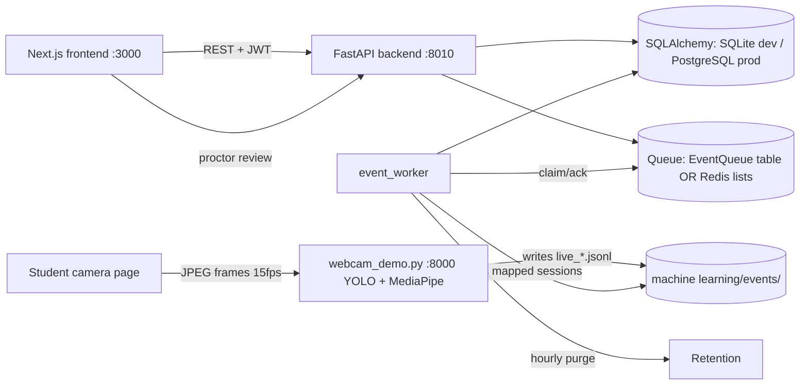

# Architecture — AIsmering

## Main modules

- `frontend/` — Next.js 15 App Router, all 13 SRS/SDD modules. Demo fixtures
  by default; with `NEXT_PUBLIC_API_ENABLED=true` the auth / student / proctor /
  review / session flows hit the real API (`src/lib/live-api.ts`).
- `backend/app/` — one modular FastAPI app:
  - `core/` config (env-only), database (SQLAlchemy 2), security (bcrypt +
    PyJWT + HMAC-signed download tokens), deps (auth + RBAC + tenant scoping), limiter (slowapi)
  - `models.py` — all SDD §4.2 tables + `EventQueue` + `MlSessionMap`
  - `api/` — auth, exams, sessions, events (ML ingestion), review, summaries,
    recordings, reports, admin (guarded DB viewer), retention
  - `services/` — queue (two backends behind one interface: `db` default or
    `redis` reliable-queue via `QUEUE_BACKEND`), risk (configurable additive
    weights), summary (traceability-validated LLM), storage (dev-local
    adapter), retention, audit
  - `workers/event_worker.py` — independently runnable: queue consumer, ML
    JSONL bridge, hourly retention purge
- `machine learning/` — protected ML workspace; demo server + trained models.

## End-to-end data flow (the verified slice)

1. Student logs in (bcrypt + JWT) → starts an exam session (`POST /sessions`,
   idempotent) after roster + window + consent checks.
2. Student's exam page streams frames to the ML demo server; its first event
   carries the ML session id → the page registers the mapping
   (`POST /sessions/{id}/ml-register`, owner-only).
3. The worker tails `machine learning/events/live_*.jsonl`, and mapped
   sessions' events enter the durable queue.
4. The worker persists each event to `EventsFlags` (deduped by stable
   `event_id`) and accumulates the advisory `RiskScores` row.
5. Proctors list sessions, inspect events, and act (acknowledge / dismiss /
   escalate / note / override / bulk-dismiss) — every action is audit-logged
   and severity overrides retain the original detector value.

## Database relationships (summary)

`Institution` → `UserAccount` / `Exam`. `Exam` → `ProctoringPolicy`,
`RosterAssignment` ↔ students (+ accommodations). `ExamSession` (anchor)
→ many `EventsFlags`, one `RiskScores`, many `Recordings`, ≤1
`SessionSummaries`. Governance: `AuditLog` (every sensitive action),
`RetentionLog` (every purge), `Consents` (grants/revocations). Infrastructure:
`EventQueue` (pending/processing/dead + retry backoff), `MlSessionMap`
(verified ML↔exam binding).

## ML integration flow

- The demo `/ws` contract is unchanged; the backend never calls it.
- Trust boundary: client-submitted event *content* is rejected. Events enter
  only through (a) `POST /ml/events` with the `X-ML-Token`, or (b) the worker
  tailing the JSONL files the demo server already writes. Unmapped ML
  sessions are ignored — never guessed.

## AuthZ boundaries

- Roles: student / proctor / admin / appeals. Enforced server-side via the
  authenticated user row; institution scoping on every query.
- Students: own data + their roster's exams. Proctors/admin: their
  institution. Appeals: case evidence within institution. Admin-only: user
  management, retention, DB viewer, audit report.
- DB viewer: table allowlist, read-only default; deletion only for a
  **verified test institution**, in dependency order, audit-logged. Protected
  tables: `AuditLog`, `RetentionLog`, `Consents`.

## Event processing

Producer → queue (pending) → worker `claim` → persist + risk → `ack`.
Failure → `nack` with retry (exponential backoff on `db`, immediate requeue
with an attempt counter on `redis`); after `QUEUE_MAX_RETRIES` → dead-letter
with `last_error`. Replaying is safe: `EventsFlags.event_id` is unique.
Both backends verified by tests (`tests/test_queue_redis.py` needs Redis up).

## Database

Verified on **PostgreSQL 16** (docker compose, port 5433 — a native Postgres
owns 5432 on this machine) and SQLite. `alembic upgrade/downgrade` round-trip
verified. `models.ensure_utc` normalizes SQLite's naive reads; PostgreSQL
returns aware timestamps natively. JSON payloads stay in text columns on both
backends.

## How to add a new endpoint

1. Add the route to the matching `backend/app/api/*.py` (or a new file,
   registered in `main.py`).
2. Guard with `Depends(get_current_user)` or `require_roles(...)`; scope by
   `user.institution_id`.
3. Add a test in `backend/tests/` using the `world`/`tokens` fixtures.
4. Run `python -m pytest tests/ -q`.

## How to add a new event type

1. Add it to `machine learning/policy.yaml` `event_catalog` (source of truth),
   and to `EventFlagIn.known_type` in `backend/app/schemas.py`.
2. Mirror the severity map at bootstrap (`scripts/bootstrap.py` reads
   policy.yaml automatically).
3. Frontend: extend `EVENT_TYPES` in `frontend/src/lib/types.ts` and the
   catalog in `frontend/src/lib/events.ts`.

## Risk scoring

Additive severity weights from env `RISK_WEIGHTS` (defaults
`low:2,medium:8,high:20,critical:50`), exposed via `GET /ml/weights` and
labeled **unapproved implementation defaults** until the team adopts them.
Scores are advisory and never gate anything automatically.
